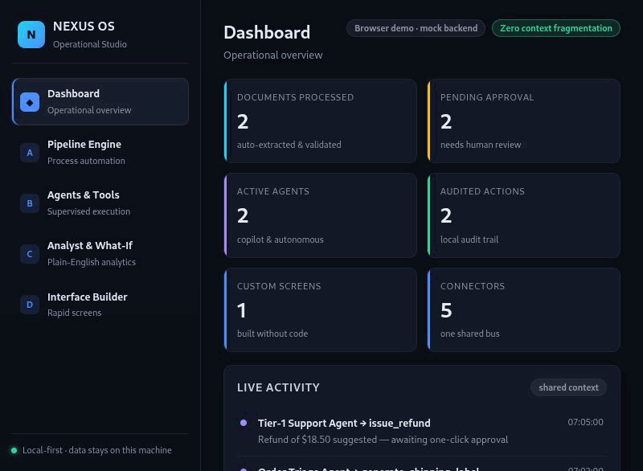
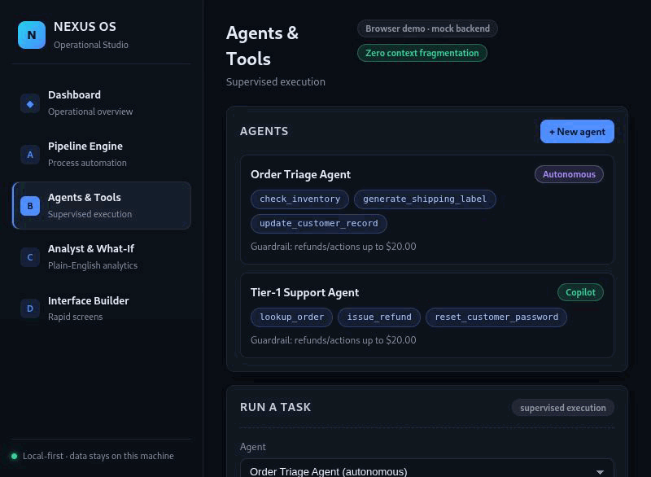
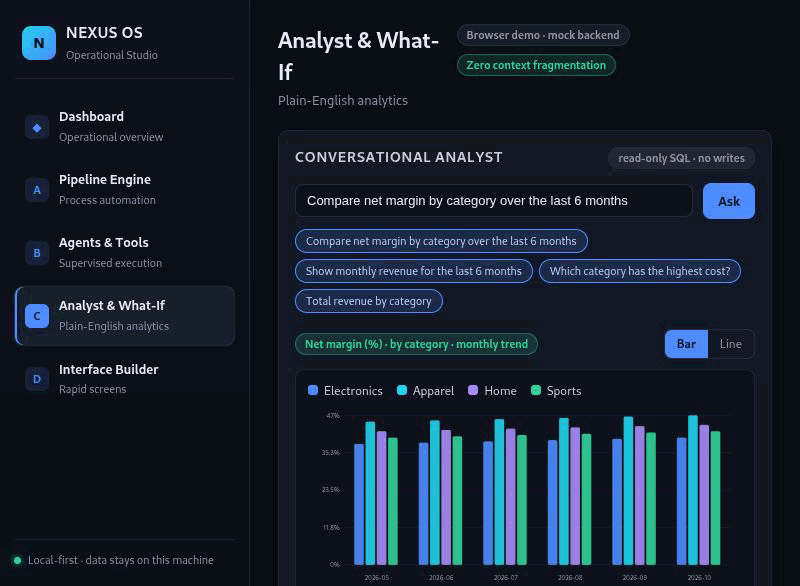
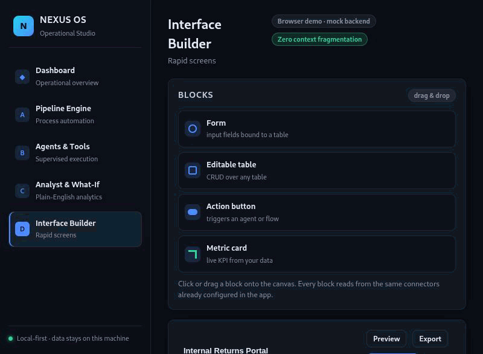
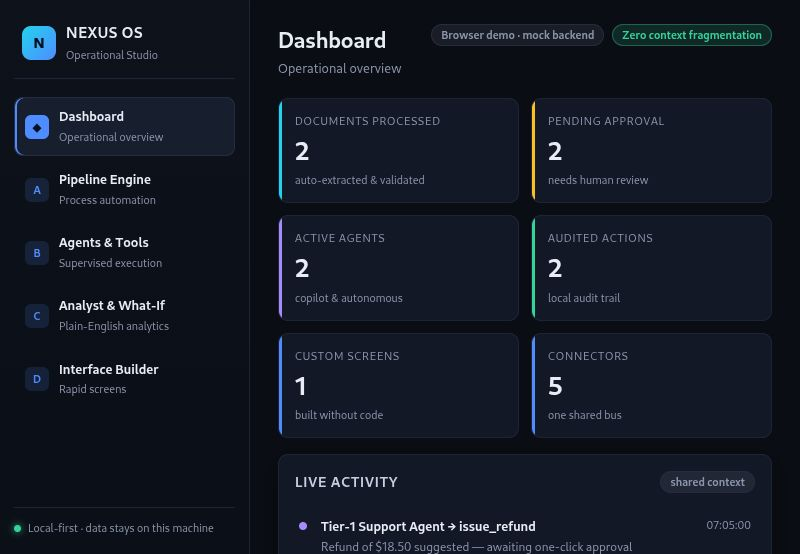
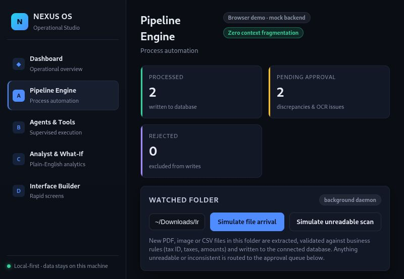
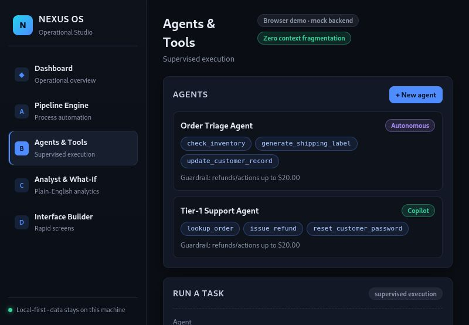
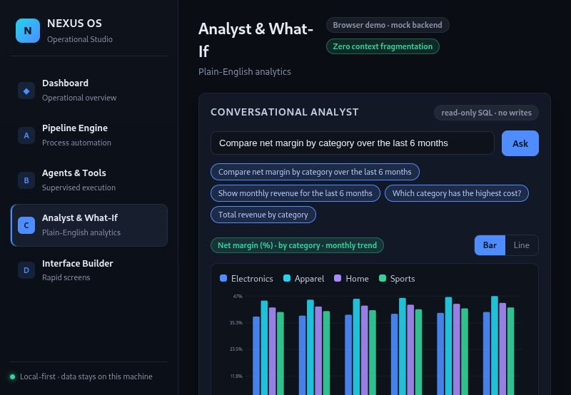
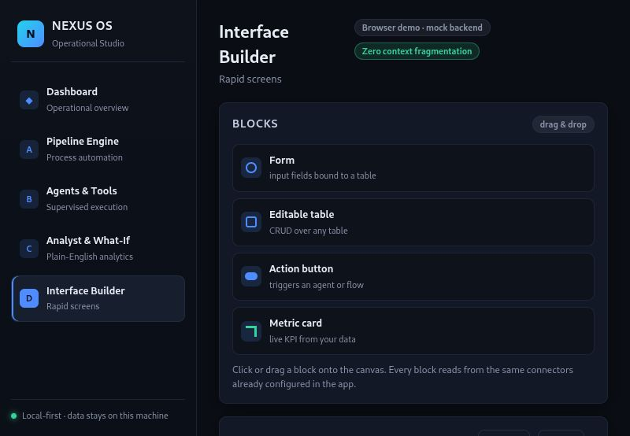

# NEXUS OS — Operational Studio

[](LICENSE)
[](https://github.com/JCmamoa/NEXUS-AI/actions/workflows/ci.yml)
[](https://github.com/JCmamoa/NEXUS-AI/actions/workflows/recruiter.yml)
[](https://tauri.app)
[](https://react.dev)
[](https://www.rust-lang.org)
[](https://github.com/JCmamoa/NEXUS-AI)

**A local-first, cross-platform operational command center for businesses.**
One lightweight desktop app (Linux / Windows / macOS) that connects to your
databases, parses documents, runs supervised autonomous agents, answers plain
English questions with charts — and lets teams build custom operational screens
in minutes, without writing code.

> Instead of subscribing to four disconnected tools, teams install a single
> application where **the pipeline, the agents, the analytics and the internal
> screens all share the same connectors and the same data**.

---

## The problem

Small and mid-sized operations teams typically run four separate products:

| Job to be done | Usual tool | Typical cost |
| --- | --- | --- |
| Document / data entry automation | Zapier / Make style SaaS | subscription |
| Internal agents & triage | a second automation SaaS | subscription |
| Business analytics & forecasting | a BI tool | subscription |
| Internal tools & dashboards | a low-code builder | subscription |

The result is **context fragmentation** (each tool knows only its own slice),
**vendor lock-in** (operational data lives on someone else's server), and a
**monthly bill that grows with the team**.

NEXUS OS collapses those four jobs into one install where every module reads
and writes the same local data store.

---

## The four integrated modules

### A · Pipeline Engine — process automation
- Watches a folder (e.g. `~/Downloads/Invoices`) for new PDF / image / CSV files.
- Extracts structured data (vendor, amount, tax ID, taxes) and validates
  business rules.
- Writes clean records directly to the connected database; anything unreadable
  or with a value discrepancy is routed to a **Pending Approval** queue.



### B · Agent & Internal Tools Hub
- Create specialized agents (e.g. *Order Triage Agent*, *Tier-1 Support Agent*)
  and choose which internal tools each one may call.
- **Copilot Mode**: the agent *suggests* an action for one-click approval.
- **Autonomous Mode**: the agent executes on its own **within guardrails**
  (e.g. refunds up to US$ 20) and is blocked otherwise.
- Every outcome is appended to a local, read-only **audit trail**.



### C · Conversational Analyst & What-If Simulator
- Ask *"Compare net margin by category over the last 6 months"* — the app
  parses the question into metric + grouping + window and generates a
  **safe, read-only aggregate SQL** query, rendering interactive charts and an
  exportable table. The generated SQL is always shown to the user.
- **What-if sliders** (average price, conversion rate, traffic, shipping cost,
  ad spend) recompute a 6-month profit / cash-flow projection **in real time**.



### D · Rapid Interface Builder
- Drag & drop pre-built blocks (form, editable table, action button, metric
  card) over a 3-column canvas to assemble a dedicated operational screen —
  e.g. an internal Returns Portal.
- **Save**, **load**, **export** the screen as a shareable configuration
  package (`nexus-os/screen-package` JSON) and **import** it on any other
  machine running NEXUS OS.



---

## Screenshots

| Dashboard | Pipeline Engine |
| --- | --- |
|  |  |
| **Agents & Tools** | **Analyst & What-If** |
|  |  |
| **Interface Builder** | |
|  | |

---

## Why it is different

1. **Zero context fragmentation** — the agent sees what the pipeline just
   extracted; the dashboard reads the actions the agents executed; the custom
   screen uses the same connectors. One data store, one truth.
2. **Total portability** — the same workflows run on executive macOS laptops,
   engineering Linux desktops and support Windows workstations.
3. **Predictable cost & data sovereignty** — no per-seat SaaS stack; database
   credentials, processed files and the audit trail never leave the machine.

---

## Architecture

```
┌────────────────────────────────────────────────────────────────────┐
│                        NEXUS OS desktop shell                     │
│                     (Tauri 2 · Rust · WebView)                    │
│                                                                    │
│  ┌────────────────────────── UI (React 19 + Vite) ───────────────┐ │
│  │  Dashboard │ A Pipeline │ B Agents │ C Analyst │ D Builder    │ │
│  └────────────┬─────────────────────────────────────┬────────────┘ │
│               │  typed IPC (invoke)                 │              │
│               ▼                                     ▼              │
│  ┌─────────────────────────┐         ┌──────────────────────────┐  │
│  │   Rust command layer    │         │  Browser demo backend    │  │
│  │  17 commands · serde DTOs│         │  (mock, same contract)   │  │
│  └───────────┬─────────────┘         └──────────────────────────┘  │
│              ▼                                                     │
│  ┌─────────────────────────────────────────────────────────────┐   │
│  │  Domain logic: extraction & rules · agent guardrails ·      │   │
│  │  NL → safe read-only SQL · screen package import/export     │   │
│  └───────────┬─────────────────────────────────────────────────┘   │
│              ▼                                                     │
│  ┌─────────────────────────────────────────────────────────────┐   │
│  │        SQLite (bundled, encrypted local app-data dir)       │   │
│  │  documents · agents · audit_log · screens · orders          │   │
│  └─────────────────────────────────────────────────────────────┘   │
│                                                                    │
│  Universal connector layer (bus): PostgreSQL · MySQL · SQLite ·    │
│  Excel/CSV · REST APIs · watched folders · IMAP inboxes           │
└────────────────────────────────────────────────────────────────────┘
        optional cloud LLM ▲          local offline models ▲
```

### Stack

| Layer | Choice | Why |
| --- | --- | --- |
| Shell | **Tauri 2 (Rust)** | small native binary, low memory, first-class Linux/Windows/macOS |
| UI | **React 19 + Vite + TypeScript (strict)** | fast dev loop, no heavy UI framework |
| Persistence | **SQLite** via `rusqlite` (bundled) | zero-config embedded DB in the app-data dir |
| Charts | **hand-rolled SVG** | zero extra dependencies, tiny bundle (~81 KB gzip) |
| Demo mode | in-browser mock backend | the whole UI runs with `npm run dev` before the native shell exists |

Both backends implement **the same 17-command IPC contract**, so the UI never
knows whether it is talking to Rust/SQLite or to the demo data set.

---

## Quick start

### 1. Browser demo (no Rust required)

```bash
npm install
npm run dev          # open http://localhost:5173
```

Everything works against an in-memory demo backend (seeded documents, agents,
audit trail, orders and screens).

### 2. Native desktop app

Prerequisites (Linux):

```bash
# system libraries (Debian/Ubuntu)
sudo apt install -y pkg-config libwebkit2gtk-4.1-dev build-essential \
  libssl-dev libgtk-3-dev libayatana-appindicator3-dev librsvg2-dev

# Rust toolchain
curl --proto '=https' --tlsv1.2 -sSf https://sh.rustup.rs | sh -s -- -y
```

Then:

```bash
npm install
npm run tauri dev     # develop
npm run tauri build   # produce .deb / .AppImage / .msi / .dmg
```

The SQLite database is created on first launch at the OS app-data directory
(e.g. `~/.local/share/com.nexusos.studio/nexus.db`) and seeded with a demo
data set so every module is alive immediately.

### 3. Docker demo (zero install)

The browser demo — same UI, same 17-command IPC contract, in-memory backend —
can be served from a container:

```bash
docker compose up --build      # http://localhost:8080
# or
docker run --rm -p 8080:80 ghcr.io/jcmamoa/nexus-ai:latest
```

The image is a two-stage build (Node → nginx, ~60 MB) and exposes a
healthcheck at `/`.

---

## Recruiter / evaluation mode

A dedicated GitHub Actions workflow — **Recruiter Demo & Stress Test** — lets
anyone evaluate the project in one click:

1. **Actions → Recruiter Demo & Stress Test → Run workflow** (choose how many
   full UI cycles to run, default `3`).
2. The workflow builds the Docker image, starts it, and an automated
   Playwright suite (`scripts/stress.mjs`) drives **every module end-to-end**
   against the running container:
   - Pipeline: file arrival, unreadable scan → approval queue, human approval.
   - Agents: copilot suggestion → approve; autonomous `$75` → **blocked** by
     the `$20` guardrail; autonomous `$5` → executed.
   - Analyst: natural-language question → chart, bar/line toggle, what-if
     slider recalculation, generated read-only SQL.
   - Builder: palette → canvas, rename, save, export package.
3. It measures step timings, console/page errors and JS heap usage, then
   publishes a **summary table** in the job page and uploads screenshots +
   `stress-report.json` as artifacts.
4. A second job builds the **native installers** (`.deb` / `.AppImage`) and
   uploads them as downloadable artifacts.

Run the same stress test locally:

```bash
npm install -D playwright && npx playwright install chromium
npm run preview &                       # or: docker compose up -d
npm run stress http://localhost:4173 3  # baseUrl, iterations
```

---

## Project structure

```
nexus-os/
├── src/                        # React frontend
│   ├── App.tsx                 # shell: sidebar + module router + toasts
│   ├── types.ts                # DTOs shared with the Rust backend
│   ├── lib/
│   │   ├── ipc.ts              # invoke wrapper (+ snake/camel key aliases)
│   │   ├── mockBackend.ts      # in-browser demo implementation
│   │   └── whatif.ts           # real-time projection model
│   ├── components/             # Sidebar, StatCard, SVG Chart
│   └── modules/
│       ├── dashboard/          # operational overview + activity feed
│       ├── pipeline/           # Module A
│       ├── agents/             # Module B
│       ├── analyst/            # Module C (NL query + what-if)
│       └── builder/            # Module D (drag & drop)
├── src-tauri/                  # Rust backend
│   ├── src/
│   │   ├── lib.rs              # Tauri builder + command registration
│   │   ├── db.rs               # schema, seeding, shared state
│   │   ├── dto.rs              # serde DTOs (camelCase ↔ TypeScript)
│   │   └── commands/           # app · pipeline · agents · analyst · builder
│   ├── icons/                  # generated PNG / ICO / ICNS set
│   ├── capabilities/           # Tauri v2 capability manifest
│   └── tauri.conf.json
├── scripts/gen_icons.py        # stdlib-only icon generator
├── docs/
│   ├── gifs/                   # module demo GIFs
│   └── screenshots/            # static screenshots
├── deploy/nginx.conf           # static hosting for the Docker demo
├── scripts/stress.mjs          # Playwright stress test (all 4 modules)
├── Dockerfile                  # Node build → nginx demo image
├── docker-compose.yml          # one-command local demo
├── .github/workflows/
│   ├── ci.yml                  # TS build + cargo fmt/check
│   └── recruiter.yml           # Docker demo, stress test, installers
├── CHANGELOG.md                # release history (Keep a Changelog)
├── CONTRIBUTING.md             # setup, checks and PR guidelines
└── README.md
```

### IPC command contract (17 commands)

| Module | Commands |
| --- | --- |
| Shared | `app_stats`, `connections_list` |
| A · Pipeline | `pipeline_list_documents`, `pipeline_ingest`, `pipeline_decide` |
| B · Agents | `agents_list`, `agents_create`, `agents_run`, `agents_approve`, `agents_audit` |
| C · Analyst | `analyst_query`, `analyst_sample_questions` |
| D · Builder | `builder_list_screens`, `builder_save_screen`, `builder_delete_screen`, `builder_export_screen`, `builder_import_screen` |

---

## Verification status

Validated end-to-end in the browser demo (React 19 strict mode, TypeScript
strict build, zero console errors):

- **Pipeline**: simulated file arrival → extraction → Pending Approval queue →
  human approve/reject updates the record.
- **Agents**: Copilot suggestion → one-click approve → executed; Autonomous run
  above the guardrail → blocked (`$75.00 exceeds autonomous limit of $20.00`);
  every outcome appended to the audit trail.
- **Analyst**: *"Compare net margin by category over the last 6 months"* →
  4-series × 6-month chart, result table and the generated read-only SQL;
  sliders recalculate the projection instantly (e.g. conversion 2.4% → 5.5%
  moves M6 revenue from $29k to $67k).
- **Builder**: drag/click block add, screen rename, save (upsert), export of a
  valid `nexus-os/screen-package` JSON download.

---

## Roadmap

- [ ] Real folder watcher daemon (notify + `tauri-plugin-fs`) and native
      notifications for pending approvals.
- [ ] Live connectors: PostgreSQL / MySQL drivers, Excel/CSV parser, IMAP and
      REST connector UI with credential vault (OS keychain).
- [ ] LLM-backed NL→SQL (with a local offline model option) behind the same
      read-only query validator.
- [ ] Document extraction pipeline on the Rust side (OCR + field rules engine).
- [ ] CI packaging matrix (.AppImage / .deb / .msi / .dmg) and code signing.
- [ ] Screen package signing so shared configurations can be trusted.

---

## Documentation

- [`CHANGELOG.md`](CHANGELOG.md) — release history.
- [`CONTRIBUTING.md`](CONTRIBUTING.md) — setup, checks and pull request guidelines.
- [`docs/gifs/`](docs/gifs/) — animated module demos.
- [`docs/screenshots/`](docs/screenshots/) — static screenshots.
- CI: [`.github/workflows/ci.yml`](.github/workflows/ci.yml) runs the TypeScript
  build plus `cargo fmt --check` and `cargo check` on every push and PR.

---

## License

MIT (see `LICENSE`).
